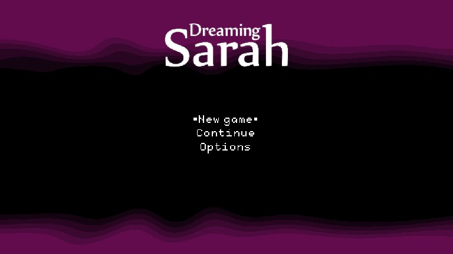
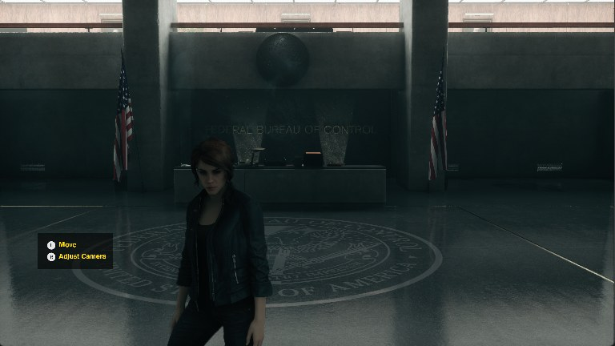

# AnyPS5 (fork with the port launcher)

Fork of [boykopovar/AnyPS5](https://github.com/boykopovar/AnyPS5), a relinker that converts PlayStation 5 executables
into native Windows and Linux programs (no emulation: the PS5's Zen 2 code runs as it is, the system libraries are
reimplemented). This fork adds the launcher the other recompilers use, so a game is converted and started from
**your own decrypted dump** with a few clicks. No game content (dump, executable, data or converted code) is in this
repository.

## How to play a game

Windows 10/11 x64 with a Vulkan GPU and a CPU with AVX2. About 1 GB free per game and a few minutes for the first
conversion; the game itself is not copied.

1. Get this repository, either way:
   - `git clone --recurse-submodules https://github.com/batatinhafcbatatinha-pixel/AnyPS5.git`, or
   - **Code > Download ZIP** and unpack it, or
   - only [`Launcher.exe`](https://github.com/batatinhafcbatatinha-pixel/port-installer/releases/latest/download/Launcher.exe):
     run it, pick AnyPS5 and a folder, and it downloads this repository there.
2. Run **`Launcher.cmd`** (it downloads `Launcher.exe` from the
   [port-installer releases](https://github.com/batatinhafcbatatinha-pixel/port-installer/releases) the first time).
3. **File > Add game folders** with the folder that holds your dumps (or drop that folder on the window). A dump
   folder has `eboot.bin` and `sce_sys/param.json`; the game is recognised by its title id (`PPSA01949`). Fake-signed
   files with `.esbak` backups and decrypted SELF containers both work; an encrypted dump does not.
4. Confirm **Install**. The launcher installs Python if it is missing, links the dump into the game's folder (nothing is
   copied) and [`tools/ps5port`](tools/ps5port/ps5port.py) converts `eboot.bin` and every module with the AnyPS5
   relinker (pinned release, downloaded into `.local/tools`). No C++ Build Tools are needed. Log: **Log** and
   `.local/ports/<title id>/setup-log.txt`.
5. **PLAY**. **Configure** holds the PC settings: window or fullscreen, the output resolution the game is told,
   V-Sync mode, performance panel and its corner, console language, volume, mute in background, vibration. In the game:
   F10 performance panel, F11 fullscreen, F12 screenshot, F5/F6/F8 volume and mute.

Every PS5 game takes the same generic path; there are no per-game profiles. Tested so far:

| Game | Dump | State |
| --- | --- | --- |
| Dreaming Sarah | PPSA02929 | title menu at 60 fps; PC settings checked in game |
| Control Ultimate Edition | PPSA01949 | reaches gameplay at about 2 fps |

## Differences from upstream

- [`tools/ps5port/ps5port.py`](tools/ps5port/ps5port.py): `build` (unwrap the SELF containers, find the module folders,
  relink for Windows, fill `app0/` with junctions and links to the dump), `play` (PC settings as AnyPS5 variables, log
  in `build/out/game-log.txt`), `env` (print those variables)
- launcher + one-click convert/play (`Launcher.cmd`, `launcher.json`, [port-installer](https://github.com/batatinhafcbatatinha-pixel/port-installer)
  submodule in `tools/port-installer`)
- the AnyPS5 code itself is upstream's, unchanged

## Building

Nothing is compiled to play: the launcher uses the relinker and Windows system libraries of AnyPS5 release v0.1.4.
One game without the launcher (the same steps it runs; `-Source` is your dump folder, the port folder is made by the
launcher's generic path, or copy `setup.json`/`installer.json` from another port):

```bat
git clone --recurse-submodules https://github.com/batatinhafcbatatinha-pixel/AnyPS5.git
cd AnyPS5
powershell -ExecutionPolicy Bypass -File tools\port-installer\setup\setup.ps1 -GameDir .local\ports\PPSA01949 -ToolsDir .local\tools -Source "D:\Dumps\PPSA01949-app0"
.local\ports\PPSA01949\Play.cmd
```

`ps5port.py build` uses a local AnyPS5 build instead of the release when `ANYPS5_RELINKER` and `ANYPS5_LIBS` point to
its `relinker.exe` and `libs` folder. Building AnyPS5 itself: [docs/dev/BUILD.md](docs/dev/BUILD.md).

## Screenshots

Each game at the furthest point it reaches today.

<table>
  <tr>
    <td align="center" width="50%">
      <br>
      <b>Dreaming Sarah</b><br>
      <sub>PS5 &middot; title menu</sub>
    </td>
    <td align="center" width="50%">
      <br>
      <b>Control Ultimate Edition</b><br>
      <sub>PS5 &middot; gameplay, Federal Bureau of Control lobby</sub>
    </td>
  </tr>
</table>

## Upstream

This repository is a fork of [boykopovar/AnyPS5](https://github.com/boykopovar/AnyPS5); its documentation is in that
project's README ([translations](docs/user/)), [usage](docs/user/USAGE.md), [input mapping](docs/user/INPUT_MAPPING.md),
[architecture](docs/dev/ARCHITECTURE.md) and [progress](https://boykopovar.github.io/AnyPS5/progress.html).

AnyPS5 is intended for interoperability, research, preservation and compatibility. It does not include, distribute or
require copyrighted software, firmware, cryptographic keys or proprietary libraries. It is not affiliated with,
authorized or endorsed by Sony Interactive Entertainment; "PlayStation" and "PS5" are trademarks of Sony Interactive
Entertainment Inc.

## License

GNU General Public License version 2 only, as upstream ([LICENSE](LICENSE)).
