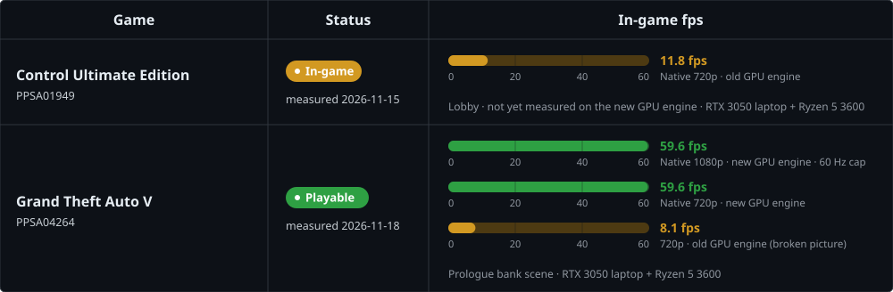

# Games: frame rate with this fork

Measured with this fork on an **RTX 3050 laptop GPU (8 GB) + Ryzen 5 3600**, 60 Hz display (60 fps is the limit).
The game's own code runs natively (relinked); the numbers depend on the GPU engine.

| Game | Scene | Setting | fps | Picture |
| --- | --- | --- | --- | --- |
| *Control Ultimate Edition* (PPSA01949) | lobby of the Federal Bureau of Control | native 720p, old GPU engine | 11.8 | right |
| | | new GPU engine | not measured yet | |
| *Grand Theft Auto V* (PPSA04264) | bank scene of the prologue | native 1080p, new GPU engine | **59.6** (900 s runs without a crash) | right |
| | | native 720p, new GPU engine | **59.6** | right |
| | | 720p, old GPU engine | 8.1 | broken |

**Grand Theft Auto V at 1080p (or 720p):** in the game choose **Performance** in the graphics settings (the patch
replaces that mode's sizes), then put
[`render-1080p-output-1080p.json`](https://github.com/batatinhafcbatatinha-pixel/recomp-patches/tree/main/ps5/PPSA04264)
(or `render-720p-output-720p.json`) from recomp-patches into `.local/ports/PPSA04264/patches/` (one of them only) and
press **PLAY**. The patches hold addresses and values only (no game code).

[Back to the README](../README.md)
